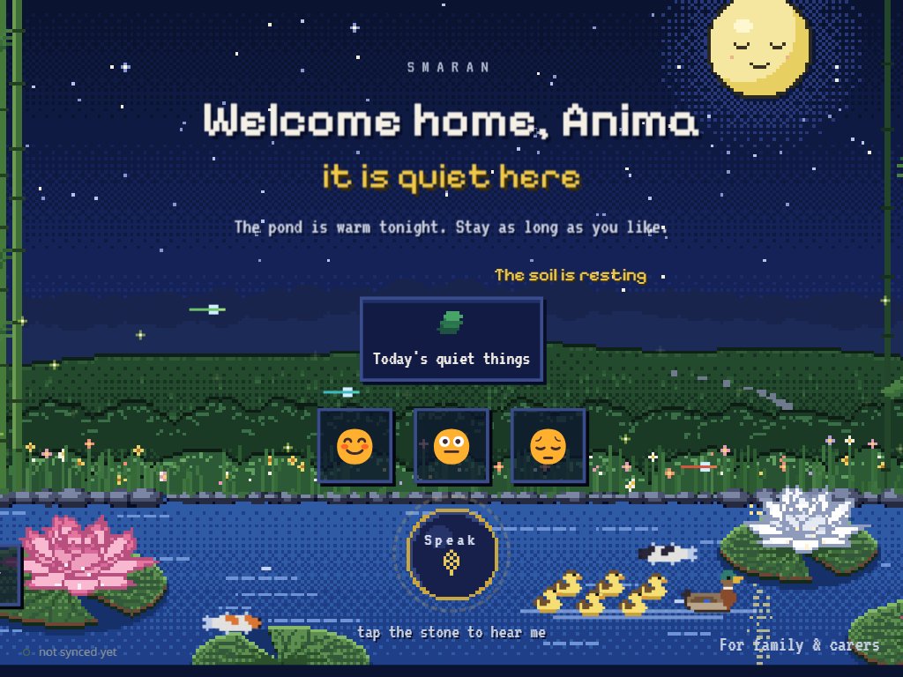
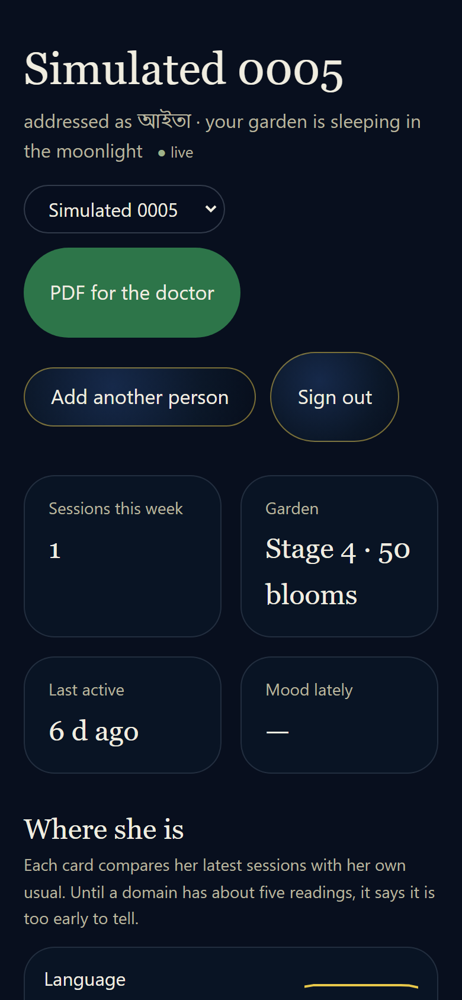
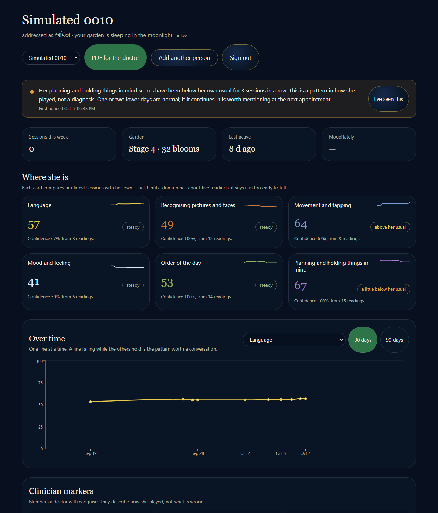
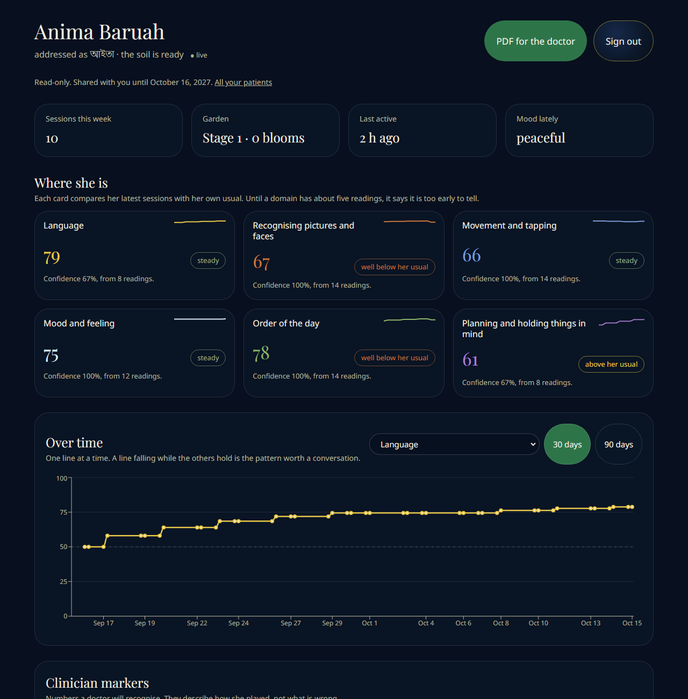
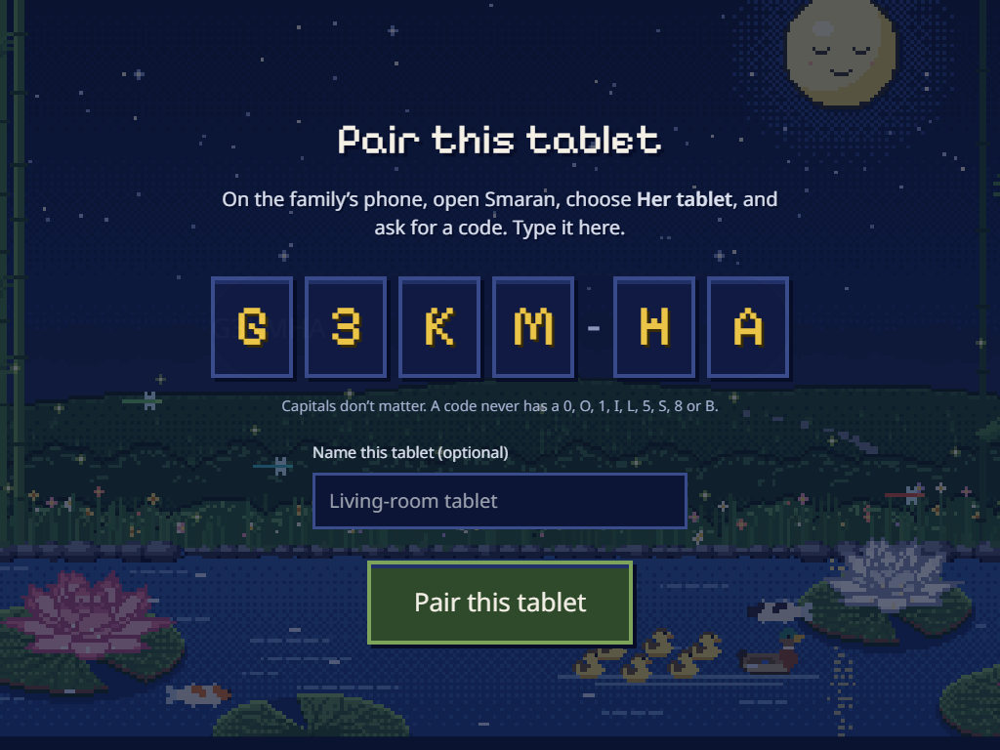
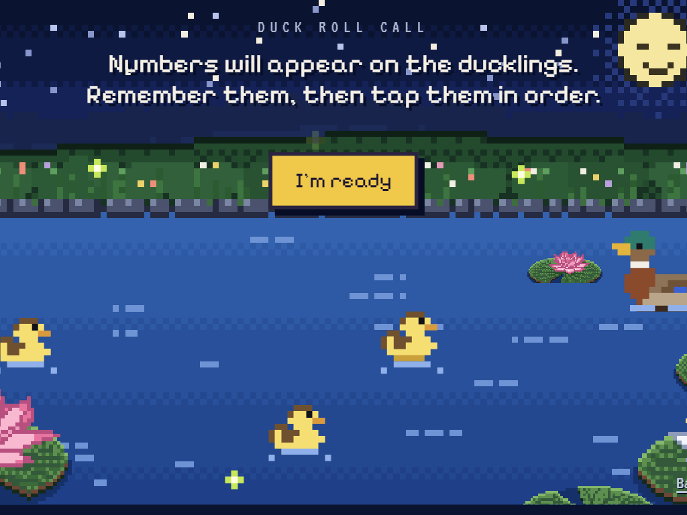
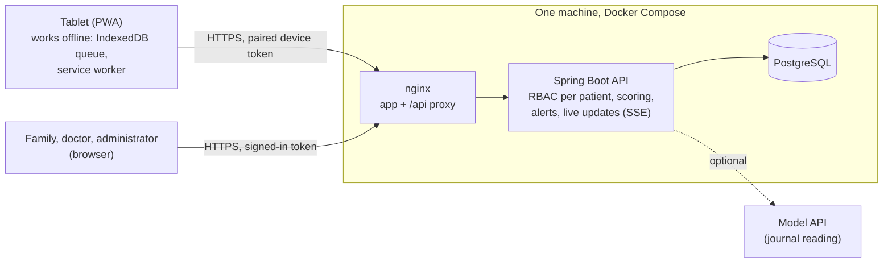

# Smaran

*Sanskrit: to remember.*

A companion for people living with dementia, and a quiet dashboard for the family and the clinician around them. The
person plays a few calm, culturally rooted games on a tablet, in a pond at the edge of a bamboo forest, and never sees a
score. Behind the pond, what she does is turned into readings of six cognitive domains, which her family and her doctor
can follow over time and be told about when something seems to be changing.

> **Read this first.** Smaran is a research prototype. Every patient in this repository is **synthetic**. It is **not a
> medical device**, it has **not been clinically validated**, and nothing in it diagnoses anything. The data-science
> results describe how the software behaves on a simulated world, not how people with dementia behave.

<p align="center">
  
  
</p>

| The family's dashboard | The doctor's read-only view |
|---|---|
|  |  |

| Pairing a tablet with a code | A game (Duck Roll Call) |
|---|---|
|  |  |

All pictures are of the demo stack (`make demo`), with synthetic people.

---

## Run it

You need Docker and `make` (on Windows without `make`, run the one `docker compose` line in the `Makefile` under `demo:`).

```bash
git clone https://github.com/ameesha1524/smaran.git && cd smaran
make demo            # builds the images (several minutes the first time), starts the stack, loads the synthetic cohort
# open http://localhost:8081     sign in as rupa@example.com / smaran
```

That is the whole product on your machine: PostgreSQL, the API, the web app behind nginx, and a caregiver with 13
synthetic patients (60 to 75 days of history each: some stable, some declining, some improving). A doctor
(`meera.das@example.com`) and an administrator (`admin@example.com`) use the same password, `smaran`. These accounts
exist only in the `dev` and `demo` profiles; the backend refuses to start with them in production.

To play the tablet, open a **second browser profile** at `http://localhost:8081`, mint a code on a patient's page ("Her
tablet", "Get a pairing code"), and type it on the tablet's `/pair` screen. `make demo-down` stops everything and deletes its data.

Other commands (the top of the `Makefile` lists them all): `make verify` (every test), `make e2e` (the browser
tests against the demo stack), `make ds` (the data-science results, about ten minutes), `make rehearse` (a deployment,
a rollback, a backup and a restore, on this machine).

---

## How it fits together



A game ends on the tablet in a **session**: the raw rounds, a reading for each domain it touched, and the reason for it.
The tablet queues sessions on the device and sends them when it can. The server checks them (it re-scores the games it
can from the raw rounds and says so on the session), keeps one record of each (a replayed batch changes nothing), updates
the patient's profile and tells open dashboards at once. The same scoring rules exist in TypeScript, Java and Python,
held to one file of shared test vectors, so the three cannot drift apart unnoticed.

[`docs/ARCHITECTURE.md`](docs/ARCHITECTURE.md) has the deployment picture and the path from a merge to a running release;
[`docs/rbac-architecture.md`](docs/rbac-architecture.md) says who may see what, and `AuthorizationMatrixIT` holds it as a table of
329 cases; [`docs/RUNBOOK.md`](docs/RUNBOOK.md) is how to run it.

---

## What is built, and what is only designed

**Built** means it runs, and a test or a recorded run shows it. **Designed** means there is a design or a shape in the code and
it should not be mistaken for a working feature.

| | Status | What that means |
|---|---|---|
| The tablet app: pond, six games, six languages, offline queue | **Built** | The games are Duck Roll Call, Koi Are Jumping, The Lotus Frog, Grandmother's Tale, Family Grove and Morning Rituals. Sessions queue offline and sync once (showcase test, step 5). The five non-English languages are the project brief's best attempt and are **unreviewed** by a native speaker (marked `reviewed: false` in the code) |
| Pairing a tablet with a code; removing it | **Built** | A code works once and lasts three days; a removed tablet is refused and goes quiet without alarming her |
| Server-side access control | **Built** | Family, caregiver, doctor, administrator and device principals; per-patient checks on every request; "404, never 403" for a patient you may not see |
| One scoring engine | **Built** | Six domains, confidence-weighted, in TypeScript, Java and Python, against shared vectors |
| The family and doctor dashboards | **Built** | Domain trends and status, clinician markers, alerts, recent sessions with their reasons, an activity map, live updates; a read-only doctor view of the patients who shared with her |
| Alert rules and a sundowning check | **Built** | Measured on simulated patients (below). The shipped alerting is noisy: see the results |
| The data-science layer | **Built** | A simulator with known ground truth, four alert rules evaluated against it, sensitivity and reliability analyses |
| Containers, CI, CD, backups, observability | **Built, rehearsed on one machine, never run on a real server** | See "Deployment" |
| The journal's reading of how she feels | **Built, optional** | Needs a model API key; without one the entry is saved on her tablet and nothing is read |
| The research data export | **Built** | Administrator only, de-identified (not anonymous), for synthetic data in practice: the consent notice does not yet cover research use |
| Voice markers, face-geometry adaptation | **Code exists, not covered by the end-to-end test** | On the tablet and in the dashboard's voice panel; not exercised in the showcase |
| Family photographs and voice notes | **Designed** | Storage and the tablet's side exist; the screen on which a family uploads them does not |
| Federated learning | **Designed** | The tablet trains and encrypts an update with a key only it holds, so the server cannot average it: it is the shape of the protocol, not the protocol |
| Medicine reminders and caregiver SMS | **Designed** | `NotificationService` logs identifiers and sends nothing until a push and an SMS provider are configured |
| Zero-knowledge audit logs | **Not started** | The audit log is an ordinary table |
| A deployment on a public address | **Not done** | Needs a server, a domain and secrets; `docs/RUNBOOK.md` is the checklist |
| Clinical validation of anything | **Not done, and not claimed** | |

---

## What the data science found

`data-science/` simulates a year of play for hundreds of patients, with the truth known (who really declines, from when and how
fast), and asks how well the alert rules and the scoring behave. **Every result depends on the simulation's assumptions**, each
listed with its reason in [`data-science/README.md`](data-science/README.md); none is estimated from patients. The numbers below
are from [`data-science/results/SUMMARY.md`](data-science/results/SUMMARY.md), and `make ds` reproduces them.

- **Alerts trade quiet for speed, and the default was changed for that reason.** An alert on two low sessions in a row fired about
  **22 times per stable patient-year** and found 73% of real declines within 90 days. The default is now **three in a row**: about
  **5 false alarms a year**, finding 44% of declines within 90 days, with a median delay of 80 days instead of 44. A family
  told every two to three weeks that something may be wrong stops listening; this was the owner's decision, made on these numbers.
- **At the same false-alarm budget, CUSUM is the best rule**: 26% of declines within 90 days at one false alarm a year, against 7 to 9% for the others.
- **One session is a poor measure; an average of several is a good one.** Test and retest agreement is 0.67 for a single session, 0.95 for the mean of seven.
- **Practice hides decline.** A true fall of 1.7 points a month looks like 0.1 if practice effects are ignored and 1.5 if they are modelled.
- **The sundowning check cries wolf**: at its shipped settings, about 58% of simulated patients with no late-day dip are flagged at least once in a year.
- **Federated learning does not pay at this size**: it matches centralised training (AUC 0.69 against 0.70) and loses to a model each patient trains on her own history (0.78).

---

## Is it tested?

The showcase script in `docs/MASTER_PROMPT.md` (section 4) is run by Playwright in three browser profiles: a family, a tablet and a doctor.
It signs in, adds a patient with guardian consent, pairs a tablet, plays Duck Roll Call and the Lotus Frog, goes offline and back, checks
that a doctor sees only the patients shared with her, and revokes the tablet. The full record of every command run and what it printed is
the **verification report** in [`docs/PROGRESS.md`](docs/PROGRESS.md). In short, at the time of writing: 108 backend unit tests and 440 integration tests on PostgreSQL
(including the 329-case authorization matrix), 145 frontend tests, 83 data-science tests, the browser suite, an accessibility check
(axe-core, WCAG 2.1 A and AA) of the family, doctor and administrator screens, and a deployment rehearsal; and a load test with its numbers and limits in [`loadtest/README.md`](loadtest/README.md).

What these do **not** show: that anything works on a real server, that the accessibility is good enough (automated checks find
about a third of the problems, and no one has used the screens with a screen reader), or anything about real patients.

---

## Deployment

Pushing to `master` runs CI and, when it passes, builds and publishes both images; a protected `production` environment then deploys over SSH,
checks health and a real smoke test (sign in, pair, send a session, read it back), and **puts the previous release back automatically if either fails**.
A deliberately broken release (one that never starts, and one that is healthy but cannot do its job) is rolled back by `make rehearse`, which CI runs on every change.

**There is no public deployment yet**, so there is no URL. The deploy job stays off until someone provides a server, a domain and the secrets
(`docs/RUNBOOK.md`, "The machine, one time"; items H5 and H14 in `docs/PROGRESS.md`). Rollback restores the code, not the database: backups are nightly and before every deploy, and `docs/RUNBOOK.md` says how to restore one.

---

## Known limitations

The full list, with numbers, is in `docs/PROGRESS.md`. The ones that matter most:

- **Everything is synthetic, and the science is simulated.** There is no clinical validation, and the cohort's assumptions are the project's own.
- **The server re-scores only Duck Roll Call** from its raw rounds. For the other games it checks that the readings are in range and plausible, so a tablet that lies inside the allowed range is not caught; each session says how it was checked.
- **No game measures inhibition or trajectory precision**, so those two clinician markers always read "not measured yet".
- **The five non-English languages are unreviewed.** They must be reviewed by native speakers before any pilot.
- **Late sessions are expensive**: a session that arrives out of order makes the server rebuild the profile; a tablet back online after days sends many (`loadtest/README.md`).
- **The tablet loads fonts and the vision model from public CDNs the first time**, so a first run needs internet; after that the service worker holds them.
- **The accessibility work is automated plus keyboard checks**, not a review with disabled users, and covers the family, doctor and administrator screens (the patient's screens are a different design problem).
- **Backups are on the same machine as the data** unless the operator copies them off.
- **Three Spring Framework CVEs are accepted** in `.trivyignore`, with reasons and an expiry (they need features the app does not use; the fix is a move to Spring Boot 4).

---

## Ethics and privacy

- **Guardian consent is recorded, not assumed.** The server refuses to add a patient without the guardian's consent; the form asks for the guardian's name and a box that is not pre-ticked, and the consent is stored with the version of the notice, who gave it and when. A person living with dementia may not be able to consent for herself; the guardian's consent and her own assent are different things, and only the first is recorded.
- **Data minimisation.** What leaves the tablet is a session: scores, the raw rounds of a game, and the reasons. By design in the code, her voice is reduced to a few numbers on the device and the sound is discarded, and no raw audio or video of her is kept. The journal's words go to a model provider, for one request, only if a key is configured; the server keeps numbers and a one-line summary that no screen shows, not her words.
- **Her words and her family are the family's.** Doctors see trends and readings, not the journal, family members' names, family media or raw rounds; the authorization matrix and the showcase test check this.
- **She is never shown a score, a timer, a streak or a failure.** An error is logged silently.
- **Logs carry identifiers, not names**, and never passwords, tokens or pairing codes.
- **Designed to align with India's Digital Personal Data Protection Act, 2023** (notice and consent, purpose limitation, data minimisation, a guardian's consent for a person who cannot give her own). That is a design intent, not a legal review, and it has not been audited.
- **The consent notice does not yet cover research use**, so the data export is for synthetic data until the notice and an ethics approval cover it.
- **Not a medical device.** A low reading is a reason to talk to a clinician, never a diagnosis; the one sentence the software says about voice is fixed in the code for that reason.

---

## Repository map

```
frontend/        React 18, Vite, TypeScript, PWA: the tablet, and the family, doctor and administrator screens
backend/         Spring Boot 3.5, Java 21, PostgreSQL, Flyway: the API, scoring, access control, alerts
data-science/    Python: the simulator, the alert-rule evaluation, the results
demo/            The synthetic cohort and the script that waits for it to load
deploy/          The production compose file, Caddy, deploy / rollback / backup / restore scripts, the rehearsal
e2e/playwright/  Browser tests: the showcase, accessibility, the security headers
loadtest/        The k6 script and its numbers
docs/            Architecture, the runbook, access control, the plan, the progress log and its verification report, an explainer per phase
```
