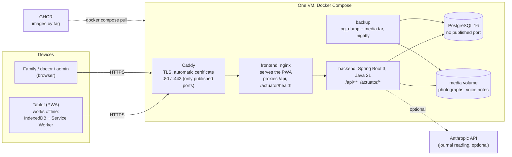
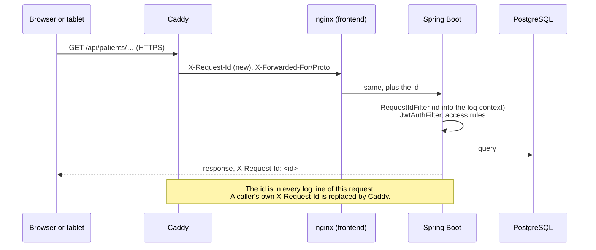
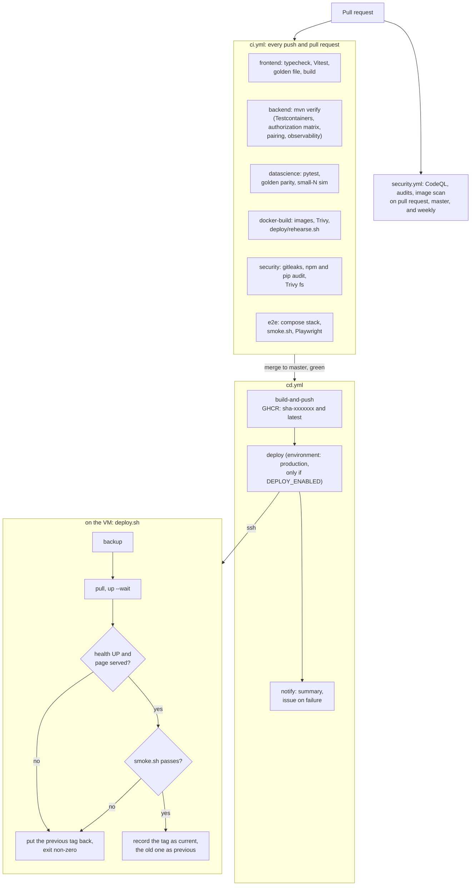
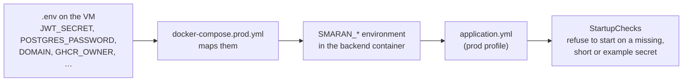

# Architecture

How Smaran is put together and how it gets to a machine. This is the map; [PLAN.md](PLAN.md) has the reasoning
behind the product, [rbac-architecture.md](rbac-architecture.md) has who may see what, and the
[RUNBOOK](RUNBOOK.md) has what to do when it is running.

## The system in one picture

Everything the browser talks to is **one origin**: Caddy takes the request, nginx either returns a file or forwards
`/api` to the backend. That is why there is no CORS in production, and why the tablet's single address is the
domain and nothing else. The database is on a Docker network marked `internal`, with no route in from outside or out.

## What runs where

| Piece | What it is | Notes |
|---|---|---|
| `frontend/` | React 18, Vite, TypeScript, PWA | After the first load and pairing it runs with no server at all; writes queue in IndexedDB and are sent later |
| `backend/` | Spring Boot 3.3, Java 21, JPA, Flyway, JWT | Stateless; the schema is in `db/migration`; scoring has a twin in the frontend with shared golden vectors |
| `data-science/` | Python | Not deployed. Reads the admin export; simulation and evaluation |
| `deploy/` | Compose file, Caddyfile, `deploy.sh`, `smoke.sh`, `backup.sh`, `restore.sh`, `rehearse.sh` | What goes on the VM |
| `e2e/playwright/` | Browser tests | Run against a built stack in CI and by `make e2e` |

Images: `ghcr.io/<owner>/smaran-backend` and `smaran-frontend`, tagged `sha-<7>` and `latest`. Both are multi-stage
builds, run as a non-root user, and have a health check. Nothing secret is in either: configuration is environment
variables read at start (twelve-factor), and the backend **refuses to start** in production without a real JWT
secret and database password.

## Request path and what the proxy decides

- `/actuator/health` and `/actuator/info` are public and reach the backend through nginx. `/actuator/prometheus`
  and everything else under `/actuator` is not forwarded by nginx and in the backend needs an ADMIN sign-in.
- Rate limits for sign-in and pairing count the real client address, which is taken from the proxy headers
  (`server.forward-headers-strategy: native`, trusted only from private ranges).
- Security headers (CSP, HSTS, `X-Content-Type-Options`, frame and referrer policy) are set at the proxies; the
  Service Worker file is never cached.

## From a merge to a running release

The smoke test signs in, pairs a tablet, has it send a session, and reads the session back from the dashboard: it
checks that the system does its job, which a health check does not. A release that is "healthy" with a broken API
fails it and is rolled back (that case is built and run in `deploy/rehearse.sh`).

**What a rollback is.** It runs the previous image tag again. It does not change the database, so migrations must be
compatible with the release before them ([RUNBOOK, Migrations](RUNBOOK.md#migrations)). The VM keeps
`state/current_tag`, `state/previous_tag` and `state/history`.

## Configuration

Two sets of names, one file format: `.env.example` documents both.

GitHub holds only what CD needs to reach the VM (`VM_HOST`, `VM_USER`, `VM_SSH_KEY`, `DOMAIN`); the application's
secrets live on the VM and nowhere else.

## Observability

- **Logs:** JSON to stdout, one event per line, with `requestId`. `docker compose logs` is the interface.
- **Health:** `/actuator/health` (public). The container health check, `deploy.sh` and the public check in CD all use it.
- **Metrics:** `/actuator/prometheus` (admin only): `sessions_ingested_total{status}`, `auth_failures_total`,
  `pairing_failures_total{reason}`, `pairing_redeemed_total`, `scoring_rescored_total`, `scoring_mismatch_total`,
  plus the JVM and HTTP metrics Micrometer gives for free.
- **Audit:** who did what to whose data is a table in the database, not a log (`/api/admin/audit`).

## Data and backups

PostgreSQL holds everything except the photographs and voice notes, which are files in the `media` volume. The
`backup` container writes a checked `pg_dump` and a media tarball nightly and before every deploy, keeping 14 daily
and 8 weekly sets, in a volume on the same machine. Copying them off the machine is the operator's job (see the
RUNBOOK); `restore.sh` puts a chosen set back.

## What this deliberately is not

One VM, not a cluster: a pilot for a few families does not need, and could not operate, more. There is one of each
service, so a deploy has a short moment in which the backend restarts (the tablets do not notice, they work
offline). There is no Redis, no message queue and no separate identity provider. If the load or the number of
families ever calls for more, the seams are already there: the backend is stateless, the database is a connection
string, media is a directory.
